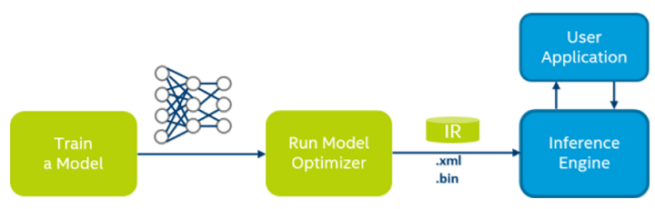

# Introduction

The contents in .yaml config file should be well structured and follow the supported rules and entity names.

# Path placeholders
Write model and data locations with these placeholders instead of absolute paths. The launch files replace them when the node starts.

|Placeholder|Resolved to|
|---|---|
|`<OPENVINO_NODE_SHARE>`|Models directory root: `$OPENVINO_TOOLKIT_DIR`, else `~/.local/share/openvino_toolkit`, else `/opt/openvino_toolkit`|
|`<OPENVINO_DATA>`|Labels and sample images installed with the package (`share/openvino_node/data`)|

When you start the node directly with `ros2 run openvino_node pipeline_with_params -config <file>`, no placeholder is replaced, so use absolute paths in that case.

# Sample
## [pipeline_people.yaml](../../sample/param/pipeline_people.yaml)
```bash
Pipelines:
- name: people
  inputs: [StandardCamera]
  infers: 
    - name: FaceDetection
      model: <OPENVINO_NODE_SHARE>/models/intel/face-detection-adas-0001/FP16/face-detection-adas-0001.xml
      engine: CPU
      label: <OPENVINO_DATA>/labels/face_detection/face-detection-adas-0001.labels
      batch: 1
      confidence_threshold: 0.5
      enable_roi_constraint: true # set enable_roi_constraint to false if you don't want to make the inferred ROI (region of interest) constrained into the camera frame
    - name: AgeGenderRecognition
      model: <OPENVINO_NODE_SHARE>/models/intel/age-gender-recognition-retail-0013/FP32/age-gender-recognition-retail-0013.xml
      engine: CPU
      label: to/be/set/xxx.labels
      batch: 16
    - name: EmotionRecognition
      model: <OPENVINO_NODE_SHARE>/models/intel/emotions-recognition-retail-0003/FP32/emotions-recognition-retail-0003.xml
      engine: CPU
      label: <OPENVINO_DATA>/labels/emotions-recognition/FP32/emotions-recognition-retail-0003.labels
      batch: 16
    - name: HeadPoseEstimation
      model: <OPENVINO_NODE_SHARE>/models/intel/head-pose-estimation-adas-0001/FP32/head-pose-estimation-adas-0001.xml
      engine: CPU
      label: to/be/set/xxx.labels
      batch: 16
  outputs: [ImageWindow, RosTopic, RViz]
  connects:
    - left: StandardCamera
      right: [FaceDetection]
    - left: FaceDetection
      right: [AgeGenderRecognition, EmotionRecognition, HeadPoseEstimation, ImageWindow, RosTopic, RViz]
    - left: AgeGenderRecognition
      right: [ImageWindow, RosTopic, RViz]
    - left: EmotionRecognition
      right: [ImageWindow, RosTopic, RViz]
    - left: HeadPoseEstimation
      right: [ImageWindow, RosTopic, RViz]

Common:
```
## Interface Description

### Specify pipeline name
The name value of this pipeline can be anything other than null.

### Specify inputs
**Note:** The input parameter can only have one value.</br>
Currently, options for inputs are:

|Input Option|Description|Configuration|
|--------------------|------------------------------------------------------------------|-----------------------------------------|
|StandardCamera|Any RGB camera with USB port support. Currently only the first USB camera is used if many are connected.|```inputs: [StandardCamera]```|
|RealSenseCamera| Intel® RealSense™ RGB-D Camera, directly calling RealSense Camera via librealsense plugin of openCV.|```inputs: [RealSenseCamera]```|
|RealSenseCameraTopic| Any ROS topic which is structured in image message.|```inputs: [RealSenseCameraTopic]```|
|Image| Any image file which can be parsed by openCV, such as .png, .jpeg.|```inputs: [Image]```|
|Video| Any video file which can be parsed by openCV.|```inputs: [Video]```|
|IpCamera| Any RTSP server which can push video stream.|```inputs: [IpCamera]```|

**Note:** Please refer to this opensource repo [RTSP_server_install_guide](https://github.com/EasyDarwin/EasyDarwin) to install RTSP server for IP Camera input.

### Specify input_path
The input_path needs to be specified when the input is Image, Video or IP Camera. 

|Input Option|Configuration|
|--------------------|------------------------------------------------------------------|
|Image|```input_path: to/be/set/image_path```|
|Video|```input_path: to/be/set/video_path```|
|IpCamera|```input_path: "rtsp://localhost/test"```|

### Specify infers
The Inference Engine is a set of C++ classes that provides an API to read the Intermediate Representation, set the input and output formats, and execute the model on devices.

* #### name
The name of the inference engine needs to be specified here. Currently, the following inference features are supported:

|Inference|Description|
|-----------------------|------------------------------------------------------------------|
|FaceDetection|Object Detection task applied to face recognition using a sequence of neural networks.|
|EmotionRecognition| Emotion recognition based on detected face image.|
|AgeGenderRecognition| Age and gender recognition based on detected face image.|
|HeadPoseEstimation| Head pose estimation based on detected face image.|
|ObjectDetection| Object detection based on SSD-based trained models.|
|VehicleDetection| Vehicle and passenger detection based on Intel models.|
|ObjectSegmentation| Object detection and segmentation.|
|ObjectSegmentationMaskrcnn| object segmentation based on Maskrcnn model.|

* #### model
The path of the model needs to be specified here. The scheme below illustrates the typical workflow for deploying a trained deep learning model.


* #### engine
The OpenVINO device the model runs on. Any device name reported by OpenVINO is accepted:

|Value|Device|
|---|---|
|`CPU`|Intel CPU|
|`GPU`, `GPU.0`, `GPU.1`|Intel integrated or discrete GPU (`GPU` selects the first one)|
|`NPU`|Intel NPU (Core Ultra processors)|
|`AUTO`, `AUTO:GPU,CPU`, `HETERO:GPU,CPU`|OpenVINO virtual devices|

To try a different device without editing the file, pass `device:=<value>` to any sample launch file, e.g. `ros2 launch openvino_node pipeline_image.launch.py device:=NPU`. It replaces the `engine` value of every model in the pipeline.

The device actually used is printed at startup and drawn on the output image next to the FPS.

* #### label
Currently, this parameter does not work.

* #### batch
Enable dynamic batch size for the inference engine net. 

### Specify outputs
**Note:** The output parameter can be one or more.</br>
Currently, the output options are:

|Option|Description|Configuration|
|--------------------|-----------------------------------------------------|---------------------------------------------|
|ImageWindow| Window showing results|```outputs: [ImageWindow, RosTopic, RViz]```|
|RosTopic| Output the topic|```outputs: [ImageWindow, RosTopic, RViz]```|
|RViz| Display the result in rviz|```outputs: [ImageWindow, RosTopic, RViz]```|

### Specify confidence_threshold
Set the threshold of detection probability.

### Specify connects
The topology of a pipe can only have one value on the left and multiple values on the right. The value of the first left node should be the same as the specified **inputs**.
